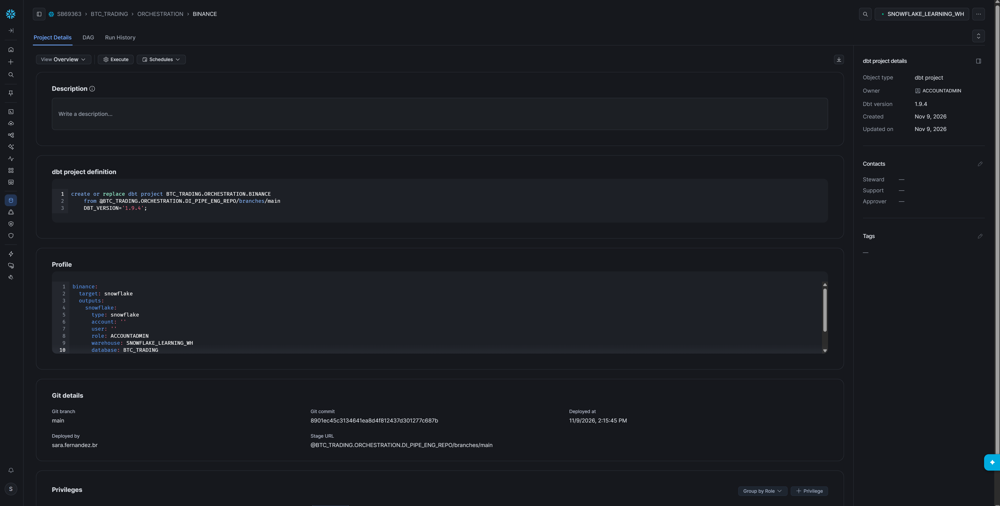
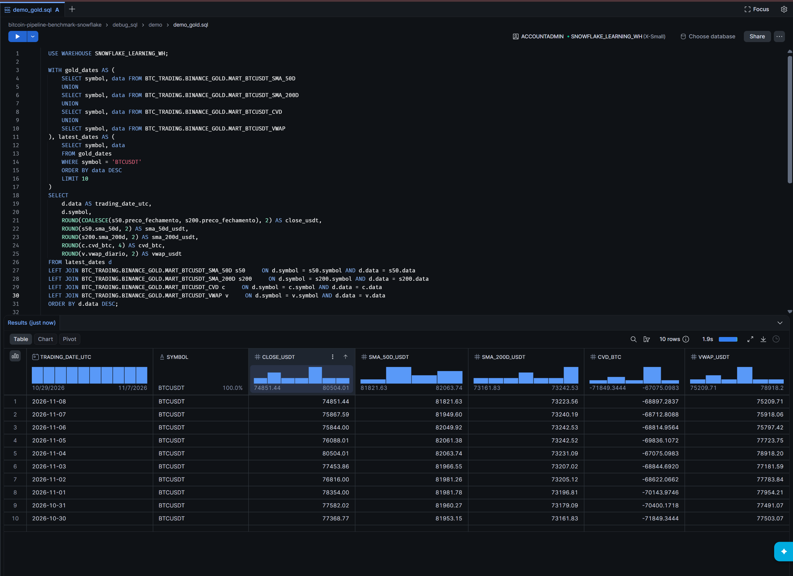

# Bitcoin pipeline benchmark · Snowflake

A daily batch pipeline that turns Binance Spot BTCUSDT trade archives into typed trades, daily OHLC and volume summaries, and four analytical marts. Snowflake Tasks orchestrate SQL ingestion and dbt transformations. This repository contains only the Snowflake implementation.

**Start here:** [Project landing page](index.html) · [Deployment to GitHub Pages](deploy_github_pages.md) · [Architecture](docs/architecture.md) · [Modelling](docs/modelling.md) · [Quality](docs/quality_checks.md) · [Backfill](docs/backfill.md)

## Source and scope

Documentation reviewed on 9 November 2026 against the supplied repository and final report. Implementation details follow this repository's SQL. Report observations are historical, with data through 6 November 2026; they are not live telemetry. See [source reconciliation](docs/source_reconciliation.md) for differences between the report and code. The original report is a separate reference and is not bundled with this Snowflake website.

## Initial setup

1. Fork or clone `https://github.com/saradfrz/bitcoin-pipeline-benchmark-snowflake`. Keep this repository's files at its root: deployment paths do **not** include a `snowflake/` prefix.
2. In Snowflake, use a role authorized to create the database, schemas, stage, tasks, procedures and dbt project. Make `SNOWFLAKE_LEARNING_WH` available. Administrative privileges were used in the prototype; production roles are still a proposal.
3. Run `setup_init/01_create_namespaces.sql`, `02_create_bronze_layer.sql`, `03_create_silver_layer.sql`, then `04_create_gold_layer.sql` in order.
4. Configure an authorized Git API integration for your repository. In `setup_init/05_deploy_orchestration.sql`, review `API_INTEGRATION = "Snowflake"` (quoted, case-sensitive name) and `ORIGIN`. The integration must exist and allow that origin. `IF NOT EXISTS` will not update an already-created repository's origin.
5. Commit/push the repository, then run `setup_init/05_deploy_orchestration.sql`. It fetches Git, creates/deploys dbt, stages the Bronze loader, deploys quality procedures and both task graphs. Child tasks are resumed; roots remain manual.
6. Inspect `SHOW TASKS IN SCHEMA BTC_TRADING.ORCHESTRATION;` and `SHOW DBT PROJECTS IN SCHEMA BTC_TRADING.ORCHESTRATION;`.

The root `setup.sql` is not the complete installer. Use the ordered scripts above.

## Prepare the landing data

From the repository root, install the downloader's dependencies (`python -m pip install requests pandas pyarrow`). Edit `local/download_files_locally.py`: set a real output folder and inclusive dates in **DD/MM/YYYY**. Choose completed UTC dates with published archives; do not keep its example end date unchanged. Run `python local/download_files_locally.py`.

The downloader obtains ZIP archives from `data.binance.vision`, extracts CSVs and converts them to Parquet. Upload files from its `parquet` folder into `@BTC_TRADING.BINANCE_BRONZE.LANDING_ZONE` using your supported stage-upload method. Expected filenames are `BTCUSDT-trades-YYYY-MM-DD.parquet`, one per UTC day. Data files stay outside Git.

## Operate

Run one graph at a time and wait for all descendants to finish:

```sql
-- Initial historical load or intentional rebuild; resets existing tables.
EXECUTE TASK BTC_TRADING.ORCHESTRATION.BINANCE_BITCOIN_FULL;
-- Daily processing after uploading new archives.
EXECUTE TASK BTC_TRADING.ORCHESTRATION.BINANCE_BITCOIN_DELTA;
```

FULL validates summary coverage from the first to the last landing date. DELTA expects summary coverage from the first landing date through **yesterday in UTC**, so upload through yesterday before starting it. The roots derive scope themselves: `USING CONFIG` dates do not restrict these graphs. An arbitrary historical slice is not an implemented runtime option.

FULL resets Bronze, Silver trades and summary, plus listed SMA/intermediate tables; Gold models then use `--full-refresh`. This is not an atomic swap: downstream failure can leave a partially refreshed dataset, including old CVD/VWAP until their builds run. DELTA loads new files, repairs count-different/missing summary dates, updates Gold and prunes data older than 366 days after all four marts succeed.

Use `debug_sql/test.sql`, `pipeline_evaluation/data.sql` and `pipeline_evaluation/costs.sql` to inspect the result. `EXECUTE TASK` returns before the graph completes; root success alone does not prove Gold success.

## Update code

Commit and push, wait for active graphs to finish, then run `setup_redeploy/01_redeploy_orchestration.sql`. Fetch alone does not deploy dbt or copy the Bronze script to its execution stage. The redeploy file's comment about adding a recovery graph is obsolete: ordinary DELTA performs supported summary backfill.

## Documentation and website

The root `index.html` presents the Snowflake and dbt project. It uses the eight supplied screenshots at `img/<original-filename>.png`; CSS and diagram previews are embedded in the HTML. Readable companion guides and downloadable diagram sources are in `docs/`.

| Item | Repository destination |
|---|---|
| `index.html` | Repository root |
| Contents of `docs.zip` | Extract at repository root; creates `docs/` and `.nojekyll` |
| `README.md` | Repository root |
| `deploy_github_pages.md` | Repository root |
| Your eight PNG images | `img/` at repository root, preserving filenames |

GitHub Pages must publish **main / (root)** so the root `img/` directory is served. See [deployment instructions](deploy_github_pages.md). Preview from the repository root with `python -m http.server 8000`, then open `http://localhost:8000`.

- [Architecture](docs/architecture.md)
- [Working with dbt](docs/dbt.md)
- [Modelling](docs/modelling.md)
- [Quality checks](docs/quality_checks.md)
- [Backfill and recovery](docs/backfill.md)
- [Retention](docs/prune_366.md)
- [Execution evidence](docs/benchmark.md)
- [Image inventory](docs/image_checklist.md)
- [Editable diagrams](docs/diagrams.md)

## dbt implementation

I use **dbt** for the Silver and Gold SQL transformations. The deployed project `BTC_TRADING.ORCHESTRATION.BINANCE` uses dbt **1.9.4**, sourced from the `main` branch, with profile `binance`, target `snowflake` and warehouse `SNOWFLAKE_LEARNING_WH`. Snowflake Tasks orchestrate dbt builds alongside COPY ingestion, summary DQ and retention.



## Captured results

The supplied screenshots show 1,107,431,071 rows in both Bronze and Silver trades and 312 rows in the daily summary and each Gold mart. Both FULL and DELTA captures show all ten tasks succeeded. These are captured observations, not live metrics or proof of value-by-value reconciliation.



The image `snowflake-backfill-recovered.png` shows the row restored after **ROLLBACK** in the screenshot demo; it is not evidence of a DELTA backfill run. See the backfill guide for the separate recovery procedure.
