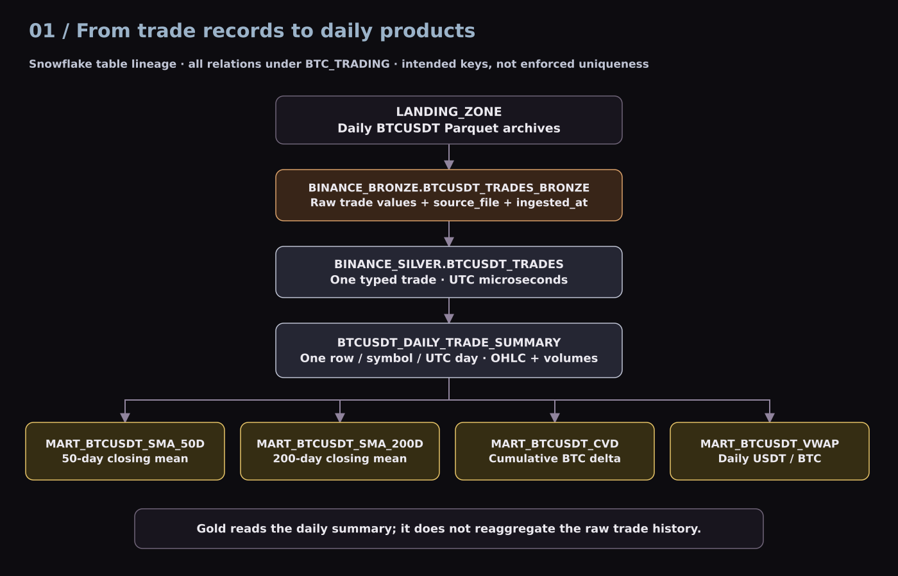
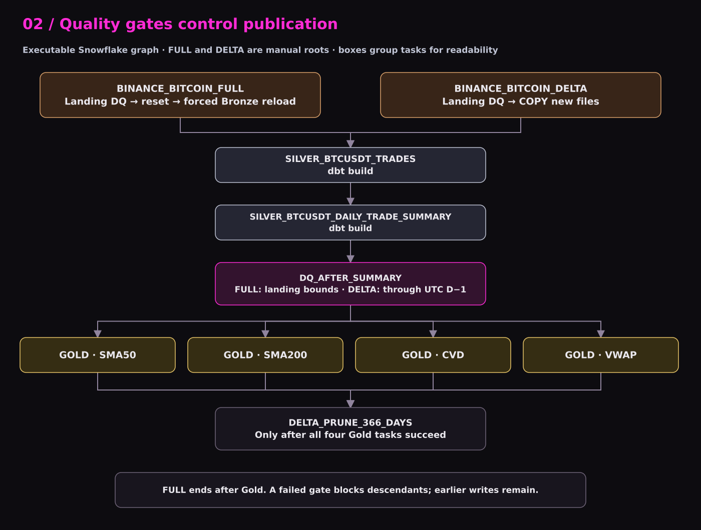
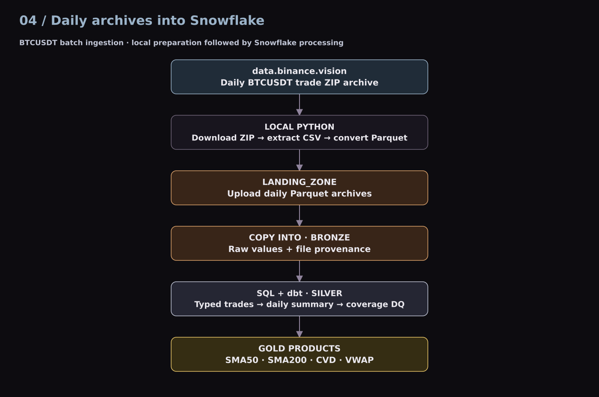
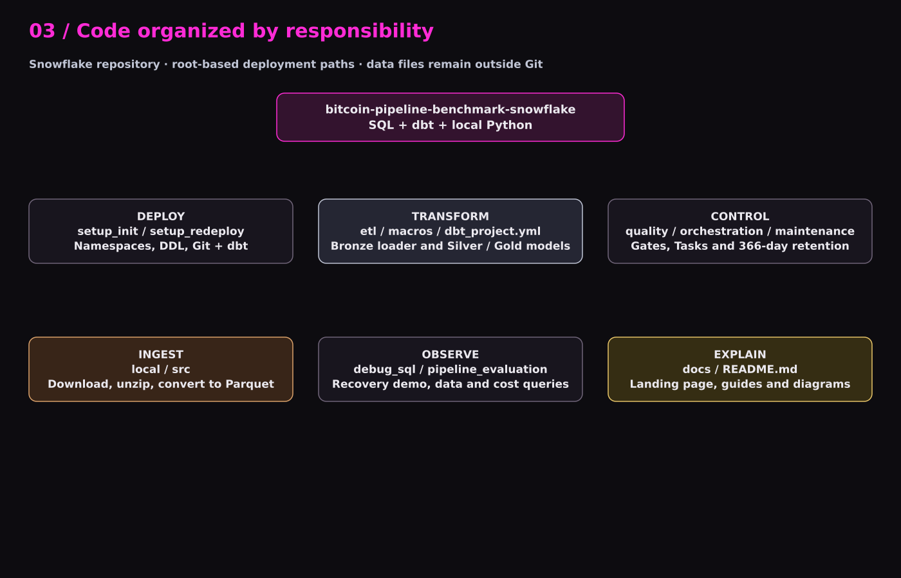
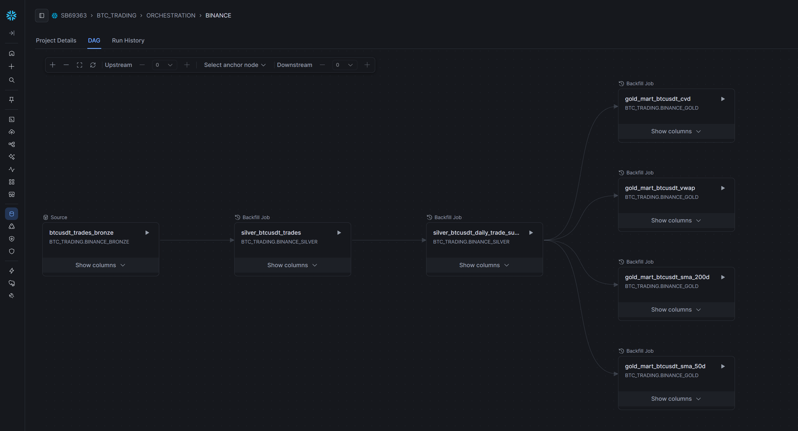
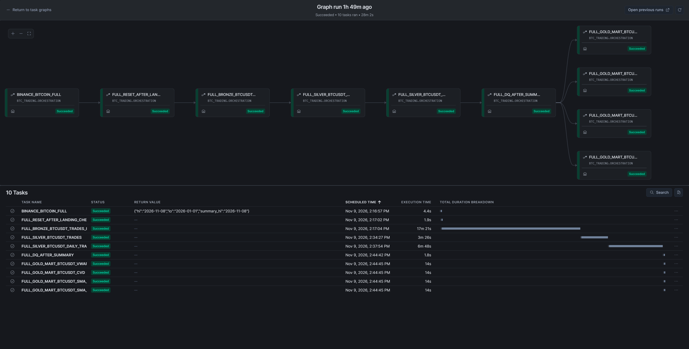
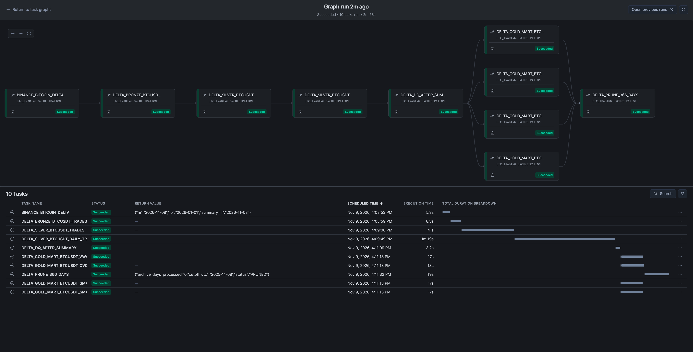

# Architecture

## What the pipeline does

BTCUSDT identifies Bitcoin traded against USDT on Binance Spot. These are exchange executions, not blockchain transactions. Public daily archives support historical analysis. Processing is daily batch with UTC dates; it is not a live market feed.

The Snowflake database `BTC_TRADING` contains `BINANCE_BRONZE`, `BINANCE_SILVER`, `BINANCE_GOLD` and `ORCHESTRATION`. Local Python downloads and converts archives; an internal stage receives Parquet. `COPY INTO` populates Bronze. A Snowflake dbt project builds Silver and Gold. Tasks establish ordering, while `ref()` establishes model dependencies. `source_file` and `ingested_at` retain file-level provenance.

The daily summary is the shared analytical input. Building indicators from approximately one row per day avoids repeating billion-row trade aggregations for each mart.

## Execution graph

Both roots call `DQ_LANDING_SCOPE` through mode-specific SQL. FULL checks landing, resets its configured tables and forces Bronze reload; DELTA leaves existing data in place and relies on load history. Both then build Silver trades and daily summary, validate summary coverage, and fan out to four Gold tasks. Only DELTA joins all four branches before retention.

A failed task blocks its dependent tasks. Earlier writes remain committed; the graph is not a single transaction. Concurrent FULL, DELTA, uploads and retention can invalidate the assumed snapshot, so operate them sequentially.

## Snowflake ingestion

Local Python downloads daily Binance ZIP archives, extracts CSV and converts it to Parquet. The files are uploaded to the internal landing stage, then COPY INTO loads Bronze. SQL/dbt and Tasks handle the downstream transformations. Local preparation reflects the account restrictions encountered in this experiment; it is not a general limitation on Snowflake external access.

## Repository responsibilities

`setup_init` and `setup_redeploy` deploy objects and code. `local` and `src` prepare files. `etl` and `macros` implement transformations. `quality` defines gates; `orchestration` defines graphs; `maintenance` handles retention; `debug_sql` and `pipeline_evaluation` support operation and measurement. `docs` is the static website and documentation. Data and credentials do not belong in the published site.

## Governance and boundaries

Engineering, operations and Gold-only consumer roles are proposed, not proven by the supplied access tests. The report's 90-day detail retention plus cold archival is also a proposal; the executable retention is 366 days with no cold-archive step. Keep enough archived lookback to rebuild SMAs, and preserve a CVD seed if a cumulative total must survive full reconstruction after pruning.

See [source reconciliation](source_reconciliation.md) before interpreting the original report's diagrams as the exact Snowflake task graph.

## dbt implementation

I use **dbt** for the Silver and Gold SQL transformations. The supplied deployment screenshot shows project `BTC_TRADING.ORCHESTRATION.BINANCE` running dbt **1.9.4** from the repository’s `main` branch. See [Working with dbt](dbt.md) for model design and deployment evidence.

## Supplied execution evidence

### Model dependencies in dbt

The dbt DAG connects the Bronze source to Silver trades, the daily summary and four Gold models.

### FULL graph · successful run

The supplied task history shows all ten FULL tasks succeeded, including reset, Bronze, Silver, summary DQ and the four Gold branches.

### DELTA graph · successful run

All ten DELTA tasks succeeded in the supplied run, ending with DELTA_PRUNE_366_DAYS.

