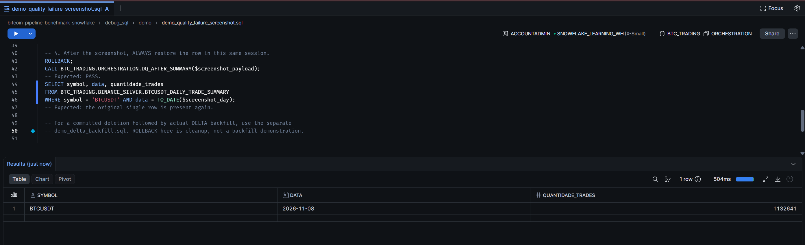

# Backfill and failure recovery

Backfill means reconstructing historical derived data from a retained source. This implementation uses the **ordinary DELTA graph** for supported daily-summary repairs; separate backfill and recovery task graphs are not deployed.

## Missing summary day

1. Ensure no graph is running. Select a date still within retained Silver and landing coverage. Upload archives through yesterday UTC so DELTA's full expected summary interval can pass.
2. Run the preflight in `debug_sql/demo/demo_delta_backfill.sql` in a single worksheet session. It verifies one summary row, source trades and baseline coverage, then creates a temporary row backup before deletion.
3. Execute its deletion and direct quality-check sections separately. The direct call must raise `BAD_SUMMARY` before repair.
4. Start `EXECUTE TASK BTC_TRADING.ORCHESTRATION.BINANCE_BITCOIN_DELTA;` and wait for the entire graph.
5. Inspect the restored summary, compare `quantidade_trades` with Silver source rows and inspect all four Gold tasks and retention. A missing summary joins with NULL count, so the model selects and rebuilds that day.

DELTA can also rebuild a day whose stored count differs from its current Silver count. If the reconstructed values equal the existing Gold inputs, Gold may correctly make no changes.

## Limits and repair choices

| Problem | Ordinary DELTA behavior | Required response |
|---|---|---|
| Missing summary, Silver intact | Recreates the summary | Use normal DELTA |
| Summary count differs | Recomputes that day's summary | Validate values and downstream tasks |
| Prices/volumes changed but count unchanged | Summary may remain stale | Explicitly rebuild summary with dbt full refresh, then update Gold, after confirming the source |
| Some Silver rows deleted from an existing file | File exclusion prevents re-append while any matching source_file remains | Repair the file's rows explicitly, or use a planned FULL from complete landing |
| Existing archive replaced under same name | COPY history / Silver file exclusion may skip correction | Controlled reload/rebuild; do not assume same-name replay works |
| Duplicate summary keys | Coverage DQ can fail; count-based merge is not a general deduplicator | Diagnose duplicates and rebuild affected data |
| History already pruned | Missing source cannot be reconstructed | Restore archives externally, plan lookback and cumulative baseline |

An explicit summary refresh can be issued when graphs are idle:

```sql
EXECUTE DBT PROJECT BTC_TRADING.ORCHESTRATION.BINANCE
  ARGS = 'build --select silver_btcusdt_daily_trade_summary --full-refresh';
```

Then validate the intended summary scope and rebuild/update all four Gold models. A full refresh of CVD resets its baseline to the first surviving summary day; do not do this casually if continuity with pruned history is required. An explicit refresh does not repair missing Silver source rows.

## Partial failures

A task graph is not an all-or-nothing transaction. Bronze and Silver may have committed before DQ fails. Confirm persisted state and error cause before replaying. The FULL reset is destructive and does not restore old tables on failure. Retention removes stage files before its transaction for table deletes; deleted stage files cannot be rolled back with the table transaction.

The ordinary DELTA graph is not a narrow backfill-only operation: it also ingests new files, updates Gold and runs retention. Its roots do not consume custom date parameters.

## Supplied execution evidence

### Demo cleanup · row restored

The worksheet shows ROLLBACK followed by the restored BTCUSDT row for 2026-11-08 with 1,132,641 trades. This capture demonstrates restoration after rollback; DELTA backfill is a separate workflow.


