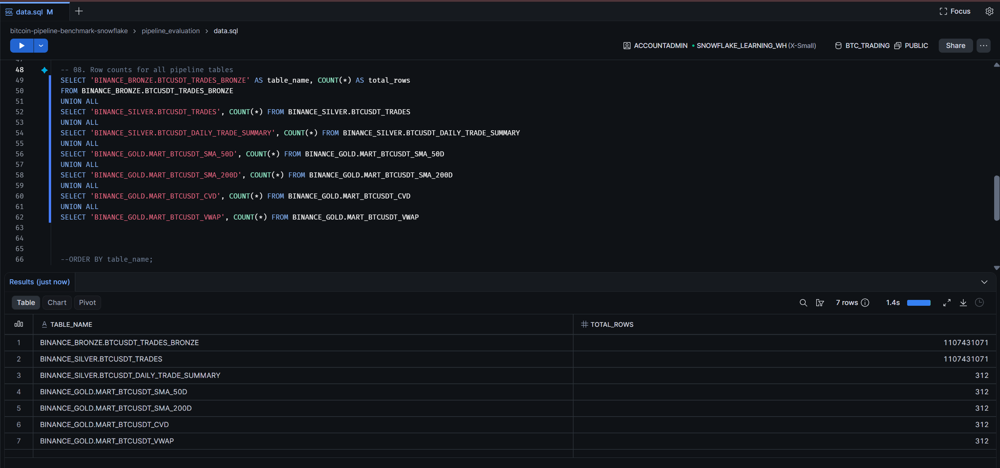

# Snowflake execution evidence

## Latest supplied screenshots

The screenshots supplied on 9 November 2026 show **1,107,431,071 rows** in both Bronze and Silver trades, and **312 rows** in the daily summary and each of the four Gold marts. The Gold preview and restored summary row include 8 November 2026. These are captured observations, not live counters; row counts alone do not prove uniqueness, continuous coverage or value equality.

Both supplied task graphs show ten successful tasks. The DELTA graph includes the final retention task. The dbt project details show version 1.9.4, while its DAG shows the source/model dependencies.

## Historical report measurements

The report's earlier snapshot through 6 November had 1,105,612,261 trades and 310 daily rows. Keep its timings and credit values attached to that historical experiment rather than treating them as measurements of the newly supplied runs.

| Measure | Historical Snowflake reference |
|---|---|
| Reference successful FULL duration | 1,882.095 seconds, approximately 31 min 22 s |
| Attributed compute for that run | 0.704936 credits |
| Illustrative conversion at USD 3/credit | USD 2.115 |
| Four successful FULL runs in the report | 24 min 45 s to 65 min 42 s |

Local download, conversion and upload are excluded. Attributed credits exclude warehouse idle time and do not represent a complete bill. USD 3 per credit is a historical report assumption. The daily USD 0.361 scenario is a projection, not a measured daily-run bill. No new credit/cost screenshot was supplied.

Use `pipeline_evaluation/data.sql` and `pipeline_evaluation/costs.sql` to collect fresh evidence over a defined measurement window.
