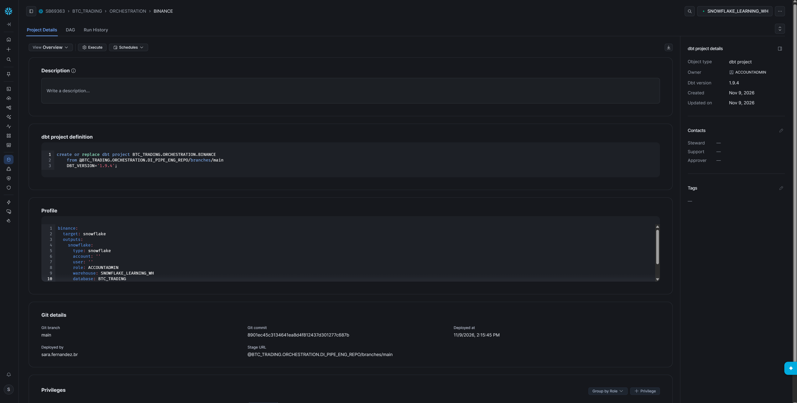

# dbt implementation in Snowflake

The platform uses **dbt** to implement the SQL transformations in the Silver and Gold layers of this BTCUSDT pipeline. Bronze ingestion uses COPY INTO; Snowflake Tasks coordinate dbt execution with ingestion, the summary quality gate and retention.

## Deployment evidence

The supplied `dbt-project.png` shows a Snowflake object of type **dbt project**, named `BTC_TRADING.ORCHESTRATION.BINANCE`, using **dbt 1.9.4**. Its definition points to `@BTC_TRADING.ORCHESTRATION.DI_PIPE_ENG_REPO/branches/main`. The visible profile is `binance`, with target `snowflake`, database `BTC_TRADING` and warehouse `SNOWFLAKE_LEARNING_WH`. Project creation and update dates are 9 November 2026. The displayed owner/profile role is ACCOUNTADMIN, reflecting the prototype deployment rather than implemented role separation.

This screenshot is evidence of deployment configuration. It does not establish that every model or task completed successfully; use the run history for execution evidence.

## What dbt does in this repository

- `dbt_project.yml` declares SQL model paths `etl/silver` and `etl/gold`, and the `macros` folder.
- `source()` connects Silver trades to Bronze; `ref()` declares dependencies from trades to summary and from summary to Gold.
- Silver trades use incremental append with file-level exclusion. The daily summary uses incremental MERGE by symbol and date.
- Gold models use incremental MERGE and calculate the affected dates for SMA50, SMA200, CVD and VWAP. FULL tasks invoke Gold with `--full-refresh`.
- `etl/silver/sources.yml` declares a not-null test for Bronze `source_file`. The separate SQL summary quality procedure checks daily coverage; it is not a dbt model test.
- Snowflake Tasks invoke `EXECUTE DBT PROJECT BTC_TRADING.ORCHESTRATION.BINANCE ARGS = 'build ...'`. Git fetch and dbt deployment are explicit operational steps.

The screenshot pins dbt 1.9.4 in its CREATE definition. The supplied initial setup SQL does not explicitly pin that version; the image documents the observed deployment, not a version guarantee for every fresh setup.

## Gold preview screenshot

Run `debug_sql/demo/preview_gold.sql` after all four Gold tasks succeed. It joins the four marts over their ten latest distinct BTCUSDT dates, shows the closing price, SMA50, SMA200, CVD and VWAP, and rounds values only for readability. Save the result grid with column headers as `snowflake-gold-preview.png`. NULL values can represent incomplete SMA windows or missing mart rows; this is a display query, not a quality certification.
