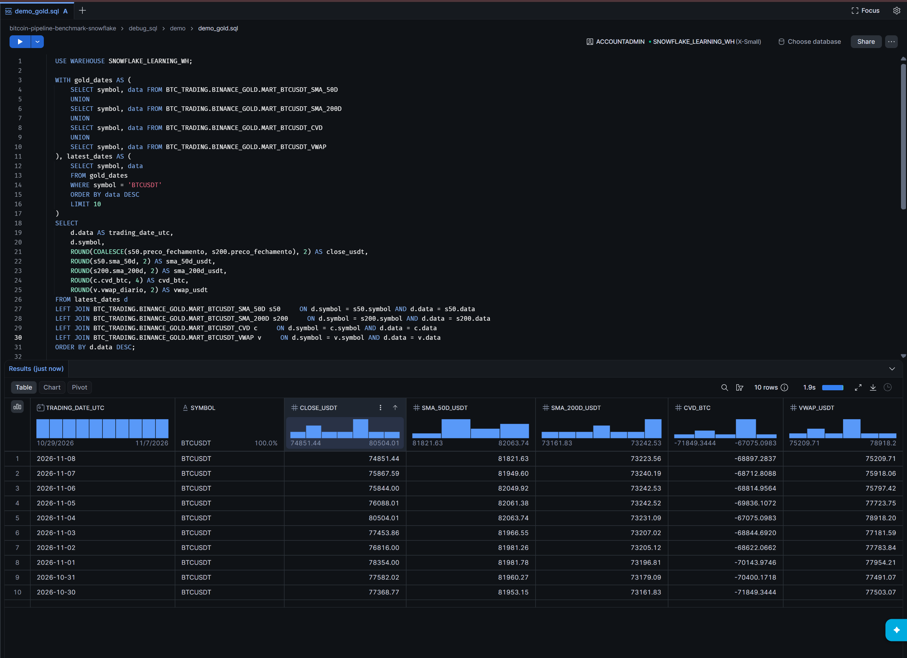

# Data modelling and indicators

The design is a layered trade fact and daily aggregate model. It is not a dimensional star schema with separate date, asset or venue dimensions. Table names below are qualified under `BTC_TRADING`.

| Relation | Grain / intended key | Materialization and role |
|---|---|---|
| `BINANCE_BRONZE.BTCUSDT_TRADES_BRONZE` | One source trade record | Raw string fields plus provenance; COPY from Parquet |
| `BINANCE_SILVER.BTCUSDT_TRADES` | One trade; logical identity `(symbol, trade_id)` | Incremental append; typed fields; file-level exclusion |
| `BINANCE_SILVER.BTCUSDT_DAILY_TRADE_SUMMARY` | `(symbol, data)` | Incremental MERGE; one UTC-day aggregate |
| `BINANCE_GOLD.MART_BTCUSDT_SMA_50D` | `(symbol, data)` | MERGE of closing price and SMA50 |
| `BINANCE_GOLD.MART_BTCUSDT_SMA_200D` | `(symbol, data)` | MERGE of closing price and SMA200 |
| `BINANCE_GOLD.MART_BTCUSDT_CVD` | `(symbol, data)` | MERGE of daily delta and cumulative BTC delta |
| `BINANCE_GOLD.MART_BTCUSDT_VWAP` | `(symbol, data)` | MERGE of daily volumes and VWAP |

Logical keys describe intended grain. The supplied models do not enforce trade uniqueness: Silver uses append, not a trade-key MERGE. Existing filenames are excluded if any Silver row with that `source_file` exists.

## Typed trade contract

`trade_id` and `trade_time_us` become BIGINT; `price`, `quantity` and `quote_quantity` become DECIMAL(38,8). Boolean strings become BOOLEAN only for `true` and `false`. The epoch timestamp is interpreted at microsecond scale using `TO_TIMESTAMP_NTZ(..., 6)`; `trade_timestamp_utc` is a UTC value stored without a timezone. Invalid conversions can become NULL. `source_file` and `ingested_at` preserve provenance. These conversions are not a rejection/quarantine policy.

## Daily aggregation

Partition by symbol and the UTC date of the trade timestamp. Opening and closing prices follow `(trade_time_us, trade_id)` ascending and descending respectively, making equal-time ordering deterministic when identifiers differ. Maximum/minimum are trade-price extremes; `preco_medio_simples` is the unweighted mean of trade prices.

`quantidade_trades` counts rows, `volume_total_btc` sums quantity and `volume_total_usdt` sums quote quantity. `is_buyer_maker = false` means buyer aggression; `true` means seller aggression. Buyer minus seller volume produces `delta_btc` and `delta_usdt`. The summary also stores aggressor counts, daily VWAP and percentage imbalance.

On an incremental run, a day is recomputed only if its trade count differs from the stored summary count (or its summary is absent). This is not a checksum of all values. Trades with NULL timestamps are excluded from aggregation.

## Gold products

| Mart | Formula | Incremental impact of a source change on D |
|---|---|---|
| SMA50 | Mean of closes D−49 through D, only with 50 non-null closes | D through D+49 |
| SMA200 | Mean of closes D−199 through D, only with 200 non-null closes | D through D+199 |
| CVD | Previous cumulative BTC delta + today's buyer-minus-seller BTC volume | First changed day through all subsequent available days |
| VWAP | Daily USDT volume / daily BTC volume | Changed day only |

SMA windows are calendar-day ranges, not simply the previous N rows. Incomplete windows yield NULL. Zero BTC volume yields NULL VWAP. CVD incrementally seeds from the preceding retained Gold value; a full rebuild starts at zero on the first available summary day.

For example, 2 BTC bought aggressively at 80,000 USDT and 1 BTC sold aggressively at 83,000 produce 243,000 USDT of volume, a VWAP of 81,000 and delta of +1 BTC. If the previous CVD is 10 BTC, the next value is 11 BTC.

Gold detects changes to its input fields, but it cannot detect a correction that Silver has not propagated. Source deletions are also not automatically removed from MERGE targets. See [backfill](backfill.md).

## dbt implementation

I use **dbt** for the Silver and Gold SQL transformations. The supplied deployment screenshot shows project `BTC_TRADING.ORCHESTRATION.BINANCE` running dbt **1.9.4** from the repository’s `main` branch. See [Working with dbt](dbt.md) for model design and deployment evidence.

## Supplied execution evidence

### Gold products · ten-date preview

Query results show closing price, SMA50, SMA200, CVD and VWAP for ten dates through 2026-11-08. Values are rounded for display.

