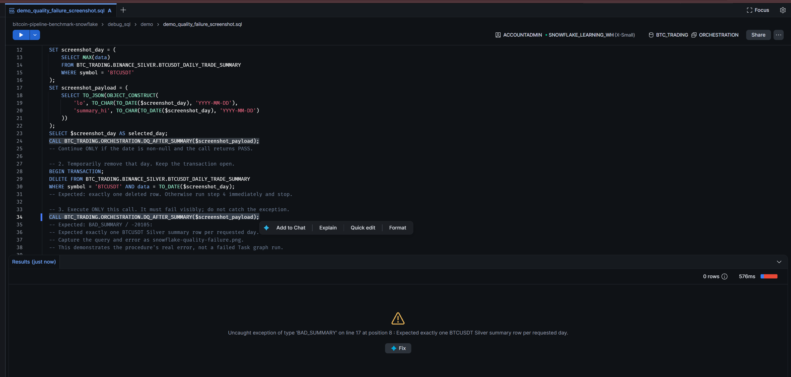

# Quality controls · implemented Snowflake behavior

Reviewed against `quality/*.sql`, `etl/silver/sources.yml` and both task graphs. The supplied PDF contradicts the code on landing validation; the code is authoritative for this repository.

| Control | Placement | What passes | Failure effect |
|---|---|---|---|
| `DQ_LANDING_SCOPE()` | Both root tasks, before COPY and FULL reset | Nonempty matching file set, valid dates/names, one archive per date and continuous min-to-max coverage | Root fails; descendants do not run |
| dbt `not_null` on Bronze `source_file` | Declared in `sources.yml`, selected through dbt build dependencies | Provenance field is not NULL | A failing selected test fails its dbt task |
| `DQ_AFTER_SUMMARY(payload)` | After summary, before four Gold branches | Exactly one BTCUSDT summary row per date in the requested inclusive interval | Gold and downstream retention are blocked |

## Scope

Landing scans matching `BTCUSDT-trades-*.parquet` files and derives `lo` and `hi` from them. It catches gaps **inside** those endpoints, duplicate daily files and invalid matching names/dates. It cannot detect that the intended first or last archive is missing because there is no independently configured expected interval. Files outside its matching pattern are not covered by this validation.

FULL passes `summary_hi = landing hi`. DELTA passes yesterday in UTC, irrespective of the latest staged date. The payload also carries `lo` and `hi` as ISO dates. Thus a stage ending too early can pass landing DQ and still fail DELTA summary DQ. Task config dates are not read by these root scripts.

Summary DQ compares `COUNT(DISTINCT data)` to `DATEDIFF(day, lo, hi)+1`, and total rows to distinct dates. It filters symbol and interval. It does not examine rows outside that interval.

## What is not implemented

There is no `DQ_BEFORE_SUMMARY` task, required `DQ_SUMMARY_BASELINE`, summary/trade-count reconciliation in the DQ procedure, comprehensive field validation, trade deduplication, or price/volume reconciliation. Count comparison in the summary model selects days to recompute; it is not an independent acceptance test. The report's broader quality rules remain proposals unless explicitly implemented in code.

## Demonstrate detection and recovery

Use `debug_sql/demo/demo_delta_backfill.sql` in a test environment, one numbered section at a time and in the same session. Its preflight checks coverage and source counts, backs up one summary row, deletes it, calls DQ directly to capture `BAD_SUMMARY`, then runs ordinary DELTA and verifies recovery.

Calling DQ **before** DELTA is essential to demonstrate the failure. DELTA may repair the missing row before its post-summary gate, in which case a successful graph is expected. Wait for descendants; do not use Run All.

For a landing-gap test, remove an **interior** day's archive from a disposable test stage after preserving a copy. `DQ_LANDING_SCOPE` should raise a missing-day error; restore it before processing. Removing the first or last file only changes the discovered bounds and does not prove missing-endpoint detection.

## Operational evidence

```sql
SELECT name, state, scheduled_time, completed_time, error_message
FROM TABLE(BTC_TRADING.INFORMATION_SCHEMA.TASK_HISTORY(RESULT_LIMIT => 1000))
WHERE database_name = 'BTC_TRADING' AND schema_name = 'ORCHESTRATION'
ORDER BY scheduled_time DESC;
```

Capture failed and successful task runs, the direct DQ error, before/after summary counts and source availability. A successful coverage check does not certify every value or prove that all four Gold tasks have finished.

## Capture the actual error for the website

Use `debug_sql/demo/demo_quality_failure_screenshot.sql` for `snowflake-quality-failure.png`. Execute its four sections separately in one session while pipelines are idle. It first checks an existing day, removes its summary row inside an explicit transaction, then calls DQ without catching the exception. Capture the visible `BAD_SUMMARY` error before executing the final `ROLLBACK` and PASS check. This is a direct procedure test; it does not create a failed Task graph run or demonstrate DELTA recovery.

## Captured failure

A direct call to DQ_AFTER_SUMMARY raises BAD_SUMMARY after the controlled removal of a summary row. This is a procedure test, not a failed Task graph.


